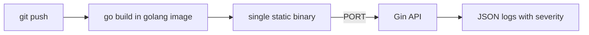

# tutorial-go-gin-api

[](https://console.light-cloud.com/new?repo=https://github.com/light-cloud-com/tutorial-go-gin-api)

A tiny link shortener in Go with Gin, used in the Light Cloud tutorial
[A Go (Gin) API deployed in five steps](https://blog.light-cloud.com/tutorials/deploy-a-go-api).



## Run it

```sh
go run .
curl -X POST localhost:8080/links -H "content-type: application/json" -d '{"url":"https://light-cloud.com"}'
curl -i localhost:8080/l/1
```

Set `GIN_MODE=release` in production.
